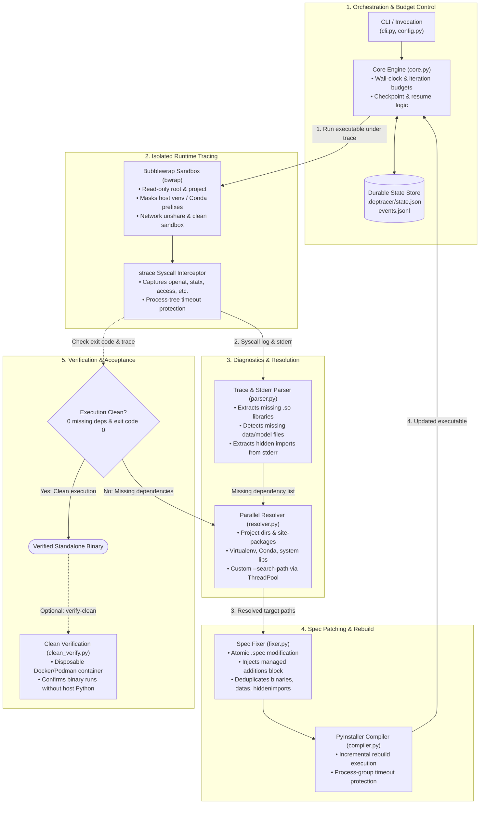

# deptracer — Reliable PyInstaller Runtime Dependency Resolver

DepTracer builds a PyInstaller application, traces runtime file access on Linux, resolves missing application dependencies, patches the PyInstaller spec, rebuilds, and repeats until the executable passes runtime verification.

## Architecture



### Component Overview

- **Orchestration & State Management (`deptracer/core.py`, `deptracer/history.py`)**: Controls the iterative convergence loop under strict wall-clock and iteration budgets. Checkpoints progress in `.deptracer/state.json` and `.deptracer/events.jsonl` for crash-safe resumption.
- **Isolated Runtime Tracing (`deptracer/tracer.py`, `deptracer/process.py`)**: Executes the application inside a Bubblewrap (`bwrap`) sandbox that isolates the network and masks active virtualenv/Conda environments to prevent silent dependency leakage. Intercepts syscalls (`openat`, `statx`, `access`, etc.) using `strace` supervised by process-group timeouts.
- **Diagnostics & Parsing (`deptracer/parser.py`)**: Parses strace output and stderr to identify missing shared libraries (`.so`), runtime data/model files, and missing Python packages (`ModuleNotFoundError`).
- **Parallel Resolution (`deptracer/resolver.py`)**: Concurrently discovers missing files across project folders, virtualenvs, Conda prefixes, system library paths, and user-specified search directories using a thread pool.
- **Spec Patching (`deptracer/fixer.py`)**: Atomically updates the PyInstaller `.spec` file with managed `binaries`, `datas`, and `hiddenimports` additions while preventing duplicate entries.
- **PyInstaller Compilation (`deptracer/compiler.py`)**: Recompiles the executable from the patched spec with timeout monitoring and process-tree cleanup.
- **Clean-Machine Verification (`deptracer/clean_verify.py`)**: Runs the final binary in a disposable Docker or Podman container to prove portability beyond the host development environment.

## Competition-enhanced version

This version focuses on the challenge's reliability requirements and adds:

- process-tree timeouts for tracing and builds
- maximum iteration and wall-clock budgets
- durable resume/checkpoint state
- parallel dependency lookup
- safer trace parsing, including versioned `.so` names and underscore-prefixed files
- configurable search paths and virtual/Conda environment discovery
- dry-run mode
- structured JSON event history
- richer `explain` diagnostics
- license metadata review
- GitHub Actions CI
- optional clean-container verification

## Install

```bash
python -m pip install -e .
```

Linux tools:

```bash
sudo apt-get install strace bubblewrap
```

## Build

```bash
deptracer build . my_app my_app.spec --max-iterations 8 --max-seconds 600 -v
```

If `dist/my_app` does not exist, DepTracer performs the initial PyInstaller build from the supplied spec.

### Dry run

```bash
deptracer build . my_app my_app.spec --dry-run
```

### Diagnostics

```bash
deptracer explain --project-dir .
deptracer explain --project-dir . --json
```

### Custom dependency locations

```bash
deptracer build . my_app my_app.spec --search-path /opt/vendor/lib
```

### License review

```bash
deptracer license
```

### Clean-machine acceptance test

After building, run the final executable in a disposable Docker/Podman container:

```bash
deptracer verify-clean dist/my_app
```

This is intentionally an integration test, not a promise that the binary runs on every Linux distribution. PyInstaller's Linux binaries remain tied to platform/architecture and system `glibc` compatibility; build on the oldest target Linux environment you intend to support.

## State

The project stores durable state in `.deptracer/state.json` and structured events in `.deptracer/events.jsonl`. The state is checkpointed before each iteration so an interrupted run repeats the in-flight iteration instead of silently skipping it.

## Important safety/accuracy note

A successful sweep is not itself proof of portability. Always validate the final executable in a clean environment and verify the application's real output. PyInstaller documents that dynamic/runtime-loaded dependencies may require explicit spec or hook configuration, and that Linux system-library compatibility still matters.
